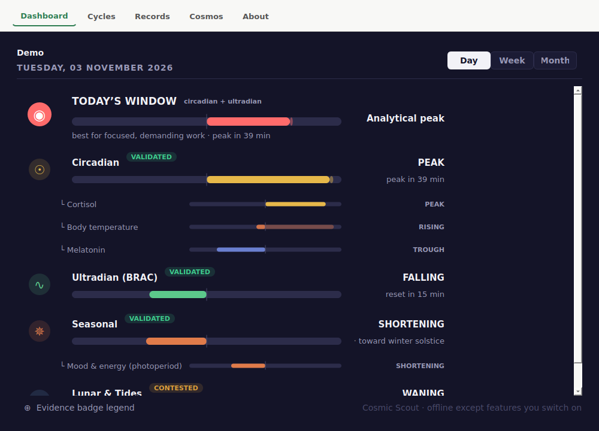
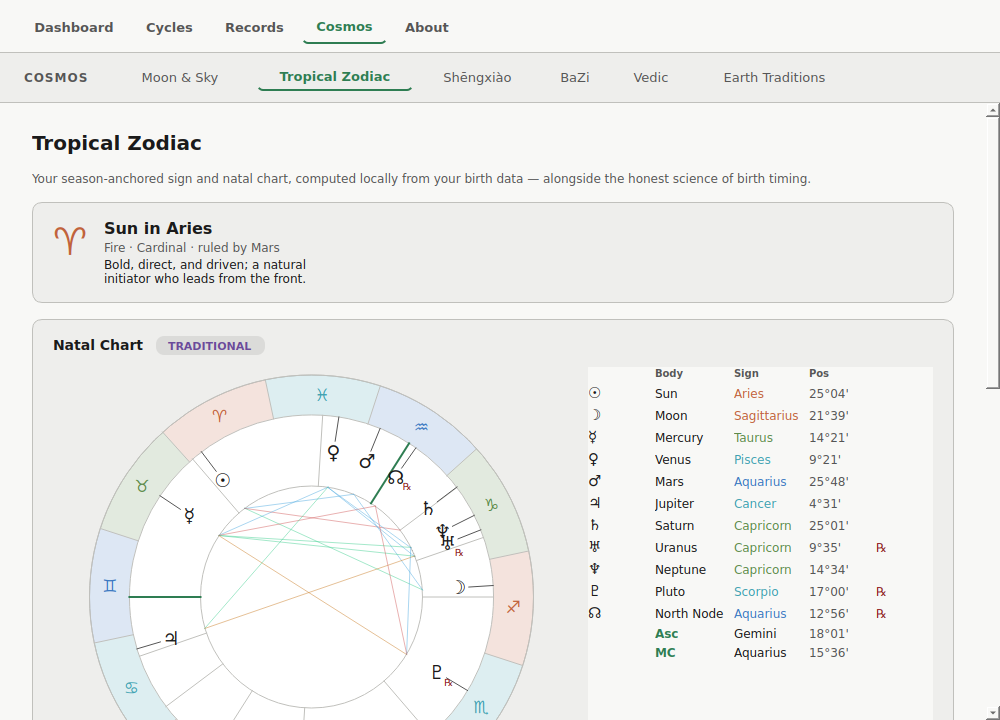

# Cosmic Scout

*Version 1.1.0 — Tuesday 10 November 2026*

A personal astrology and chronobiology desktop application for Linux (Flatpak).
Cosmic Scout computes profile-driven cycle guidance — it is a calculator, not a
static reference — and grades everything it shows by one honest test: *can a
channel of influence be named and traced?*

> Series note: previously Cosmic Harmony Scout (v1–v4) and Cosmic Compass (v5–v6);
> renamed Cosmic Scout at v1. Biorhythm has been removed — tested and found
> invalid (Hines 1998).

## Screenshots





## Architecture

Cosmic Scout runs entirely offline except for one opt-in feature (NOAA space
weather, off by default) and the Cosmos link checks you start yourself.

- **Dashboard** — the dark guidance cockpit. *Today's Window* blends only the
  validated tier (circadian + ultradian); below it, one diverging bar per cycle,
  each with its evidence badge and named sub-bars (cortisol, temperature,
  melatonin, and sex- and age-aware hormonal cycles). Day / Week / Month scales.
- **Cycles** — the reasoning behind every bar: the named channel, the evidence
  grade, and how it reads right now.
- **Records** — *Profile* (several profiles allowed), *Journal* (a 12-question
  daily log with CSV export), *Patterns* (correlations with the log and rhythm
  discovery, both biased to silence) and *Settings* (current location from an
  offline city list, and the single network opt-in).
- **Cosmos** — Moon & Sky, Tropical Zodiac (season-of-birth science and natal
  chart), Shēngxiào, BaZi, Vedic and Earth Traditions, all computed locally.
  Every tab ends with Further Reading links, saved with each profile: add or
  delete your own, and press Check links to confirm each site still answers.
- **About** — how we decide what's real: the name-the-channel test, the badge
  legend and cited sources.

## Install

### 1. Prerequisites (once per machine)

**Flatpak.** Linux Mint and Fedora come with it. Check with:

```bash
flatpak --version
```

If that says "command not found" (Ubuntu, Debian and others), install it:

```bash
sudo apt install flatpak
```

**Flathub**, where the runtime comes from. Mint already has it; adding it again does no harm:

```bash
flatpak remote-add --if-not-exists --user flathub https://dl.flathub.org/repo/flathub.flatpakrepo
```

### 2. Install the runtime (once per machine)

Cosmic Scout runs on the KDE 6.11 runtime (about 415 MB download, 1.1 GB installed):

```bash
flatpak install --user flathub org.kde.Platform//6.11
```

### 3. Download Cosmic Scout

This link always gives the latest version:
https://github.com/archerprojects/cosmicscout/releases/latest/download/CosmicScout-x86_64.flatpak

### 4. Install Cosmic Scout

In the folder you downloaded it to:

```bash
flatpak install --user CosmicScout-x86_64.flatpak
```

### 5. Run

Open **Cosmic Scout** from the Education menu, or:

```bash
flatpak run org.cosmicscout.app
```

### Updating

Cosmic Scout doesn't update itself. To update, repeat steps 3 and 4: the new version
installs over the old one, and your profiles and journal are kept.

**Coming from 1.0.0?** If Cosmic Scout won't start after updating, remove it and
install again (your data is kept):

```bash
flatpak uninstall --user org.cosmicscout.app
flatpak install --user CosmicScout-x86_64.flatpak
```

## Build from source (developers only, not needed to install)

Run from source:

```bash
python3 -m venv .venv
.venv/bin/pip install -r requirements.txt
.venv/bin/python chs/main.py
```

Cosmic Scout uses PyQt6 on the KDE 6.11 runtime (Python 3.13), native on Wayland with
X11 as a fallback. To build the Flatpak bundle yourself (the SDK and PyQt BaseApp
install system-wide):

```bash
flatpak-builder --install-deps-from=flathub --force-clean \
    --repo=repo --default-branch=stable build-dir flatpak/org.cosmicscout.app.yml
flatpak build-bundle --runtime-repo=https://dl.flathub.org/repo/flathub.flatpakrepo \
    repo CosmicScout-x86_64.flatpak org.cosmicscout.app stable
```

## Licence

GPL-3.0-or-later. Developer: archerprojects <archer.projects@proton.me>.

Bundled and third-party components, including the Swiss Ephemeris parts used
under the AGPL-3.0, are listed in [THIRD_PARTY_LICENSES.md](THIRD_PARTY_LICENSES.md).

## Data attribution

City location data (`chs/data/cities15k.json.gz`) is derived from
[GeoNames](https://www.geonames.org/), licensed under
[Creative Commons Attribution 4.0](https://creativecommons.org/licenses/by/4.0/).
The dataset is trimmed to cities with population ≥ 15,000 (name, country,
IANA timezone, latitude, longitude) and used entirely offline; the app makes
no calls to GeoNames.
